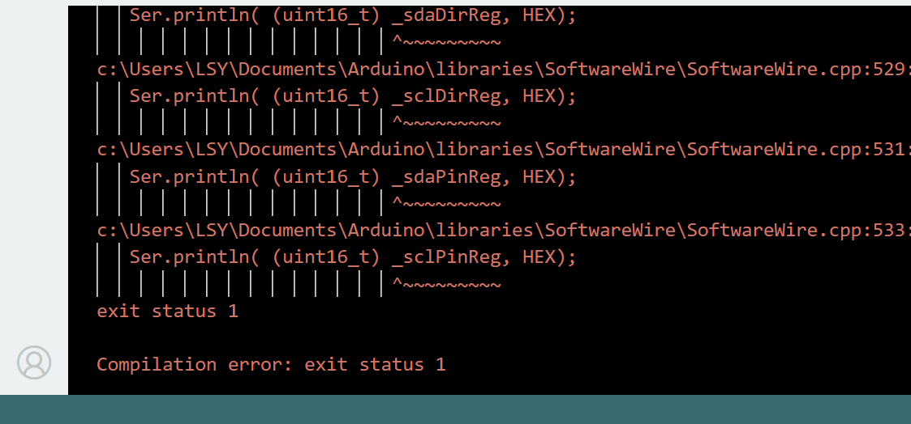
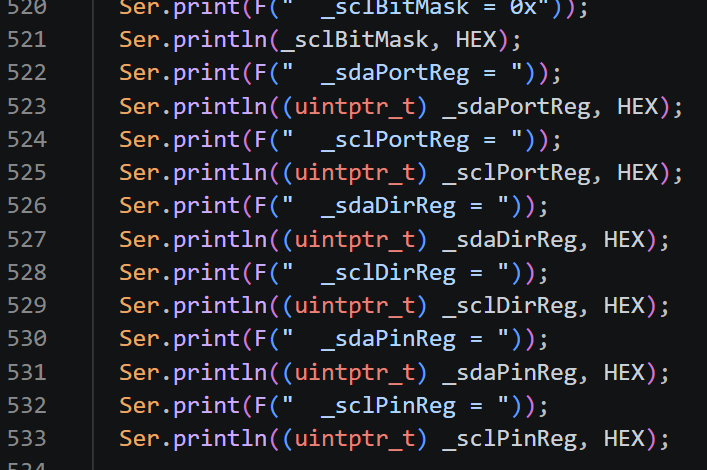
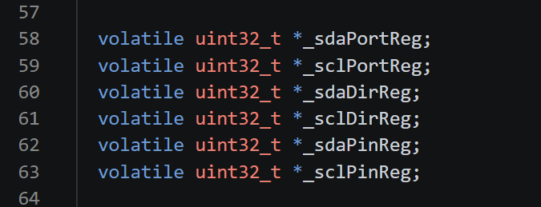

# Dual Light Sensor Lighting Control Logic

## 1. Sensors and Hardware Used

-   💡**New: Digital Push Button v3**: An additional lighting control
    input. A short press turns the lights on or off, while a long press
    changes the lighting mode.
-   **Left VEML7700 light sensor**: Reads ambient illuminance (lux) via
    I2C. When the illuminance falls below the configured threshold
    (currently 20 lux), the program treats the sensor as covered and
    triggers a lighting color change.
-   **Right VEML7700 light sensor**: Reads ambient light intensity via
    software-emulated I2C communication using `SoftwareWire`. The
    program reads the sensor data and converts it to lux. **It is used
    to automatically adjust the light brightness and is no longer used
    to detect swipe gestures.**
-   **Arduino MKR WiFi 1010**: Reads the sensors and button, processes
    the control logic, and drives the on-board RGB LED and remote LED
    strip.

## 2. Main Control Logic

### 2.1 Digital Push Button v3 Control

The program distinguishes between short and long presses based on how
long the button is held. The long-press threshold is approximately 800
ms:

-   **Short press**: If the button is held for more than 50 ms but less
    than 800 ms, the lighting state is toggled. When the lights are off,
    the RGB output values are set to 0. Another short press turns the
    lights back on.
-   **Long press**: When the button is held for approximately 800 ms,
    the program switches to the next lighting mode. Each long press
    triggers only one mode change; holding the button down does not
    repeatedly cycle through the modes.

### 2.2 Left Sensor: Color Control

-   The program continuously reads the illuminance from the left
    VEML7700.
-   When the illuminance falls below 20 lux and the sensor state changes
    from "uncovered" to "covered", the color index is incremented once,
    switching to the next lighting color.
-   Keeping the sensor covered does not repeatedly trigger color changes
    in every loop. The sensor must first be uncovered and then covered
    again to trigger the next change.

### 2.3 Right Sensor: Brightness Control

-   The program reads the ambient light intensity from the right
    VEML7700 using software-emulated I2C.
-   The brightness factor is calculated from the measured illuminance
    using the following formula:
    `brightness = constrain(luxRight / 150.0, 0.15, 1.0)`.
-   The stronger the ambient light, the higher the light brightness.
    When the ambient light is weaker, the light brightness is reduced,
    with a minimum limit of approximately 15% and a maximum of 100%.
-   Therefore, in v1.1, the right sensor is responsible for adaptive
    brightness adjustment based on ambient light and is no longer
    involved in left-to-right swipe gesture detection.

## 3. Lighting Control

-   **Colors**: The code defines five RGB colors: red, green, blue,
    purple, and cyan. The left sensor switches to the next color
    whenever it detects a new covering action.
-   **Lighting modes**: A long press of the button cycles through four
    modes:
    -   Constant (`STYLE_CONSTANT`)
    -   Breathing (`STYLE_BREATHING`)
    -   Blinking (`STYLE_BLINKING`)
    -   Random color (`STYLE_RANDOM`)
-   **On/off state**: Controlled by a short press of the button. When
    switched off, the light output is black. When switched on, the
    output follows the current color, lighting mode, and brightness
    factor calculated from the right sensor.
-   The color and mode are managed by `colorIndex` and `currentStyle`,
    respectively. The lighting on/off state is managed by `lightOn`.

## 4. Lighting Output

The Arduino controls two lighting outputs:

-   **On-board RGB LED**: The MKR WiFi 1010 updates its color and
    brightness.
-   **Remote LED strip**: Connected through an MQTT Broker over Wi-Fi.

## 5. Version Changes and Test Feedback

### Main Changes in v1.1

-   Added a button connected to D5: a short press toggles the lights on
    or off, while a long press changes the lighting mode.
-   The left VEML7700 continues to detect covering actions and switch
    the lighting color.
-   The right VEML7700 has changed from its originally intended role as
    a swipe-gesture input to an **ambient light intensity input**. It
    reads illuminance via software-emulated I2C and automatically
    adjusts the light brightness.
-   The control method has changed from "cover the left sensor to change
    color and swipe from left to right to change the lighting mode" to
    "**use the button to control the on/off state and lighting mode,
    cover the left sensor to change color, and use ambient light
    measured by the right sensor to adjust brightness**."

### Test Feedback

-   ✔ **Switch**: Works normally. The button's indicator light works as
    expected during both single presses and long presses.
-   ❌ **Both light sensors**: Neither sensor works correctly due to a
    conflict in software-emulated I2C communication. Specifically,
    "**the SoftwareWire software I2C library has a compatibility issue
    with the current compilation environment for the Arduino MKR WiFi
    1010 (SAMD21)**." Modifying both `SoftwareWire.h` and
    `SoftwareWire.cpp` did not resolve the issue. The following are
    screenshots of the compilation errors.

-   **Issue in `SoftwareWire.h`**

-   **Issue in `SoftwareWire.cpp`**

-   💡 **Possible solution**: Use a **TCA9548A I2C multiplexer** so that
    both VEML7700 sensors can share the MKR WiFi 1010's hardware I2C
    bus. Since both VEML7700 sensors have the same default I2C address
    (0x10), the multiplexer can avoid the address conflict while
    eliminating the dependency on `SoftwareWire` entirely.
